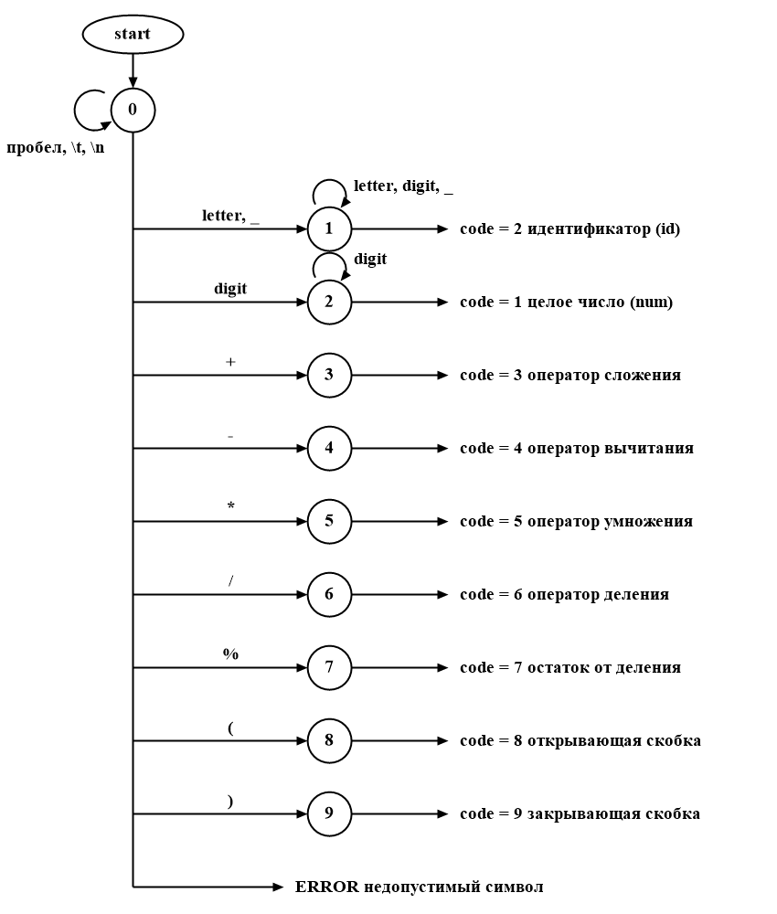
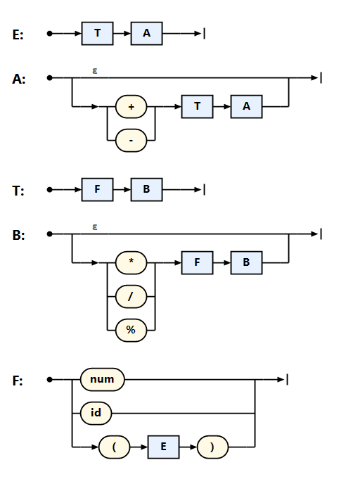

# Создание внутренней формы представления программы — лабораторная работа №6

Дисциплина «Теория формальных языков и компиляторов».

**Автор:** Лузянин З., группа АП-326

## Цель работы
Изучить методы построения внутреннего представления программы (ВПП) на основе контекстно-свободной грамматики, реализовать синтаксический анализатор методом рекурсивного спуска и преобразовать арифметические выражения в тетрады и ПОЛИЗ.

Задачи:
1. Реализовать поиск лексических и синтаксических ошибок для заданной КС-грамматики методом рекурсивного спуска.
2. Представить внутреннюю форму программы в виде тетрад (op, arg1, arg2, result) для арифметических выражений (только для корректных строк).
3. Преобразовать выражение в ПОЛИЗ (польскую инверсную запись) и вычислить его значение (только арифметическое выражение из целых чисел).

## Вариант задания
**Вариант 5.** Язык программирования: Go.

КС-грамматика арифметического выражения:
```
E  → TA
A  → ε | + TA | - TA
T  → FB
B  → ε | * FB | / FB | % FB
F  → num | id | (E)
id → letter {letter | digit}
num → digit {digit}
```
+ Vt = { `+`, `-`, `*`, `/`, `%`, `(`, `)`, num, id } — терминалы;
+ Vn = { E, A, T, B, F } — нетерминалы, E — начальный символ;
+ E — выражение, T — терм, F — множитель (число, идентификатор или выражение в скобках), A и B — «хвосты» с операциями сложения/вычитания и умножения/деления/остатка;
+ как и в Go, буквой считается также `_`; деление целочисленное, `%` — остаток от деления.

Грамматика контекстно-свободная (тип 2 по Хомскому): правило `F → (E)` задаёт вложенные скобки любой глубины. Левой рекурсии нет, поэтому грамматика подходит для рекурсивного спуска.

Примеры верных строк:
```
2 + 3 * 4
(2 + 3) * 4 - 6 / 2
a + b * (c - d) / e % 3
100 / 7 % 4 - 18 / (2 + 1) * 3
```

## Лексические и синтаксические ошибки

### Диаграмма лексера
Лексер (класс `ExprLexer`) — конечный автомат. Состояния 1 и 2 накапливают идентификатор и число. Пробелы, табуляции и переводы строк пропускаются, при `\n` увеличивается номер строки. Любой другой символ — лексическая ошибка.



### Схема рекурсивного спуска
Парсер (класс `ExprParser`) содержит по процедуре на каждый нетерминал: `E`, `A`, `T`, `B`, `F`. На схеме прямоугольник — вызов процедуры нетерминала, овал — терминал, развилка — выбор альтернативы по текущей лексеме, линия ε — пустая альтернатива (процедура ничего не читает и возвращается).



Обрабатываемые ошибки:
+ **лексические** — недопустимый символ (`@`, `$`, `.` и т. п.);
+ **синтаксические** — пропущенный операнд, пропущенный знак операции, незакрытая скобка, лишняя закрывающая скобка, пустое выражение.

После ошибки разбор продолжается, поэтому за один запуск находятся все ошибки. Если найдена хотя бы одна ошибка, тетрады и ПОЛИЗ не строятся, выводится предупреждение.

### Тестовые примеры
| Выражение | Ошибка | Местоположение |
|---|---|---|
| `2 + @ 3` | Лексическая ошибка: Недопустимый символ '@' | строка 1, позиция 5 |
| `2 +` | Синтаксическая ошибка: Пропущен операнд в конце выражения | строка 1, позиция 4 |
| `* 3` | Синтаксическая ошибка: Пропущен операнд перед '*' | строка 1, позиция 1 |
| `2 * (3 + 4` | Синтаксическая ошибка: Не закрыта скобка '(' (строка 1, позиция 5): ожидается ')' | строка 1, позиция 11 |
| `(2 + 3))` | Синтаксическая ошибка: Лишняя закрывающая скобка ')' | строка 1, позиция 8 |
| `2 3` | Синтаксическая ошибка: Пропущен знак операции перед '3' | строка 1, позиция 3 |
| `2 + + 3` | Синтаксическая ошибка: Пропущен операнд перед '+' | строка 1, позиция 5 |

Корректная строка — ошибок нет, на вкладке «Лексемы» результат лексера:


Лексическая ошибка:


Синтаксическая ошибка:


## Внутренняя форма представления программы (тетрады)
Тетрады строятся во время рекурсивного спуска. Когда процедура `A` или `B` распознаёт операцию, создаётся тетрада `(операция, левый операнд, правый операнд, ti)`, и временная переменная `ti` становится левым операндом следующей операции. Поэтому `* / %` выполняются раньше `+ -`, а операции одного приоритета — слева направо.

Для выражения `(2 + 3) * 4 - 6 / 2`:

| № | Операция | Аргумент 1 | Аргумент 2 | Результат |
|---|---|---|---|---|
| 1 | + | 2 | 3 | t1 |
| 2 | * | t1 | 4 | t2 |
| 3 | / | 6 | 2 | t3 |
| 4 | - | t2 | t3 | t4 |

Для выражения с идентификаторами `a + b * (c - d) / e % 3`:

| № | Операция | Аргумент 1 | Аргумент 2 | Результат |
|---|---|---|---|---|
| 1 | - | c | d | t1 |
| 2 | * | b | t1 | t2 |
| 3 | / | t2 | e | t3 |
| 4 | % | t3 | 3 | t4 |
| 5 | + | a | t4 | t5 |


## ПОЛИЗ
ПОЛИЗ строится алгоритмом Дейкстры (класс `Polish`):
+ число сразу идёт в выход;
+ перед тем как положить операцию в стек, из стека выталкиваются в выход операции с приоритетом не ниже (`* / %` — 2, `+ -` — 1);
+ `(` кладётся в стек, `)` выталкивает операции до `(`, скобки удаляются;
+ в конце оставшиеся операции выталкиваются в выход.

Затем ПОЛИЗ вычисляется стеком: число кладётся в стек, операция снимает два числа и кладёт результат. ПОЛИЗ строится только для выражений из целых чисел. Деление на ноль и переполнение 64-битного целого выводятся как ошибка вычисления.

Для выражения `(2 + 3) * 4 - 6 / 2`:
```
ПОЛИЗ:     2 3 + 4 * 6 2 / -
Значение:  17

Построение ПОЛИЗ (алгоритм Дейкстры):
Символ  Действие                                          Стек операций   Выход
(       '(' — в стек                                      (
2       число — в выход                                   (               2
+       операция '+' — в стек                             ( +             2
3       число — в выход                                   ( +             2 3
)       выталкиваем операции до '(', скобки удаляем                       2 3 +
*       операция '*' — в стек                             *               2 3 +
4       число — в выход                                   *               2 3 + 4
-       выталкиваем * (приоритет не ниже), '-' — в стек   -               2 3 + 4 *
6       число — в выход                                   -               2 3 + 4 * 6
/       операция '/' — в стек                             - /             2 3 + 4 * 6
2       число — в выход                                   - /             2 3 + 4 * 6 2
конец   выталкиваем оставшиеся операции                                   2 3 + 4 * 6 2 / -

Вычисление ПОЛИЗ (стек):
Символ  Действие                    Стек
2       число — в стек              2
3       число — в стек              2 3
+       2 + 3 = 5                   5
4       число — в стек              5 4
*       5 * 4 = 20                  20
6       число — в стек              20 6
2       число — в стек              20 6 2
/       6 / 2 = 3                   20 3
-       20 - 3 = 17                 17
```

Другие примеры:

| Выражение | ПОЛИЗ | Значение |
|---|---|---|
| `2 + 3 * 4` | `2 3 4 * +` | 14 |
| `(2 + 3) * 4` | `2 3 + 4 *` | 20 |
| `100 / 7 % 4 - 18 / (2 + 1) * 3` | `100 7 / 4 % 18 2 1 + / 3 * -` | -16 |
| `5 / (3 - 3)` | `5 3 3 - /` | ошибка: деление на ноль |


## Сборка и запуск
Готовая программа: `publish/win-x64/LangProcessor.exe`. Это один файл, .NET внутри него уже есть, ничего устанавливать не нужно. Нужно ввести выражение и нажать «Пуск» (кнопка ▶, меню «Пуск» или F5). Результаты выводятся на вкладках «Ошибки», «Лексемы», «Тетрады» и «ПОЛИЗ».

Сборка из исходников (нужен .NET SDK 7.0 или новее): открыть `LangProcessor.sln` в Visual Studio и нажать F5, или
```
cd LangProcessor
dotnet build
dotnet run
```
